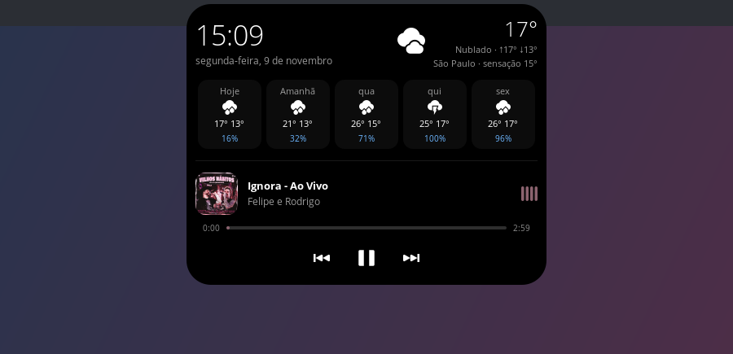

# linux-island

Uma *dynamic island* para o Linux que fica no centro do painel, no lugar do relógio. Ela mostra **hora, data, clima e o que está tocando no Spotify**. Ao passar o mouse, ela se expande com a previsão dos próximos dias e os controles de mídia.




Feita para o **COSMIC** (Pop!_OS 24.04). Veja a [compatibilidade](#compatibilidade) com outros ambientes.

## Recursos

- **Relógio e data** em português, em 24h.
- **Clima atual**: temperatura, condição, máxima, mínima e sensação térmica, via [Open-Meteo](https://open-meteo.com/), sem chave de API.
- **Previsão de 5 dias** com a chance de chuva.
- **Spotify** via MPRIS/D-Bus:
  - capa, título, artista e uma barra de progresso clicável e arrastável;
  - botões de anterior, play/pause e próxima;
  - **volume**: barra arrastável com botão de mudo, ou rolagem do mouse sobre a ilha, de 5% em 5%;
  - o equalizador e a barra de progresso usam a cor predominante da capa;
  - na troca de faixa, a pílula se estica na horizontal mostrando título e artista por alguns segundos e volta ao relógio;
  - opcional: **playlist** (ou álbum, artista, Músicas Curtidas) e **dispositivo** onde está tocando (celular, caixa de som, TV…). Quando toca em outro aparelho, aparece um ícone dele na pílula.
- **Lembrete de beber água**: uma página só para isso na ilha expandida.
  - Anel com o progresso da meta do dia, uma gota por copo, botão **+copo** e desfazer.
  - Na hora de beber, a pílula mostra **"Hora de beber água"** com a borda azul pulsando, e passar o mouse ou clicar abre direto na página da água, com o botão **Adiar**.
  - **Aviso sonoro** ao lembrar: dá para escolher o som e o volume, e testar nas configurações.
  - Notificação do sistema opcional, com **Bebi** e **Adiar**.
  - O contador zera sozinho na virada do dia.
- **Agenda** do Google, Outlook, iCloud, Nextcloud, ou qualquer agenda com link iCal: uma página com os eventos de hoje e dos próximos dias, e clicar numa reunião abre o Meet, Zoom ou Teams.
  - Antes de cada reunião, a pílula mostra **"Reunião · em 8 min"** com a borda violeta pulsando e um aviso sonoro.
  - Ao abrir a ilha, aparece o cartão da reunião com **Entrar** e **Dispensar**.
- **Animações**: a pílula muda de tamanho e de arredondamento ao expandir, e a capa e o equalizador deslizam pra dentro quando a música começa.
- **Leve**: Python + GTK3, sem polling de metadados. O Spotify avisa por D-Bus quando algo muda.

### Interação

| Ação | Resultado |
|---|---|
| Passar o mouse | expande |
| Clique esquerdo numa área livre | abre ou fecha |
| Clique do meio | play / pause |
| Rolar sobre a ilha | volume do Spotify (±5%) |
| Clique direito | menu: Configurações, Abrir o Spotify, Sair |
| Clicar ou arrastar na barra | pula para o ponto da música |
| Arrastar para o lado (com a ilha aberta) | troca de página: música/clima ↔ água ↔ agenda |
| Dois dedos para o lado no touchpad, ou clicar nos pontinhos | troca de página |

## Compatibilidade

Precisa de **Wayland** com suporte a `wlr-layer-shell`, que é o recurso que prende a ilha no topo da tela, por cima das janelas.

| Ambiente | Situação |
|---|---|
| **COSMIC** | ✅ testado; dá para substituir o relógio do painel |
| **Hyprland, Sway, river, niri, Wayfire** | 🟡 têm layer-shell e devem funcionar (não testado) |
| **KDE Plasma (Wayland)** | 🟡 o KWin tem layer-shell e deve funcionar (não testado) |
| **GNOME** | ❌ o Mutter não suporta layer-shell; precisaria de uma extensão do GNOME Shell |
| **X11** | ❌ não suportado |

Fora do COSMIC, a ilha aparece no topo, centralizada. Esconda o relógio da sua barra (Waybar, painel do Plasma…) ou ajuste a posição com `--margin` ou em *Configurações → Comportamento*. Testou em outro ambiente? Abra uma issue contando como foi.

## Instalação

Dependências (Ubuntu, Pop!_OS, Debian):

```bash
sudo apt install python3-gi python3-gi-cairo gir1.2-gtk-3.0 gir1.2-gtklayershell-0.1
```

Depois:

```bash
git clone https://github.com/mrlazarias/linux-island.git
cd linux-island
./run.sh
```

<details>
<summary>Sem sudo? Use o gtk-layer-shell localmente</summary>

O `run.sh` usa automaticamente uma cópia do gtk-layer-shell em `vendor/`, se ela existir:

```bash
mkdir -p vendor/debs && cd vendor/debs
apt-get download gir1.2-gtklayershell-0.1 libgtk-layer-shell0
for f in *.deb; do dpkg-deb -x "$f" ../root; done
```

</details>

## Configurações

Clique com o botão direito na ilha e escolha **Configurações…**, ou rode `./run.sh --settings`. Se a ilha já estiver aberta, o comando só abre a janela, sem criar uma segunda ilha. Tudo é aplicado na hora e salvo em `~/.config/linux-island/config.json`.

| Aba | O que dá para mudar |
|---|---|
| **Aparência** | temas prontos (Clássico, Vidro, Claro, Spotify, Grafite), cor de fundo com transparência, cor do texto, cor de destaque fixa ou automática pela capa, arredondamento, borda |
| **Relógio e clima** | 12h/24h, data na pílula, cidade (vazio = detectar pelo IP), °C ou °F, clima na pílula |
| **Comportamento** | expandir no hover, atraso do hover, mostrar a música nova na pílula, volume pela rolagem, distância do topo, iniciar com a sessão |

| **Agenda** | link iCal da agenda, mostrar agenda, dias à frente, avisar na pílula, quanto antes, som, volume |
| **Água** | ligar/desligar, intervalo, adiar por, meta diária, tamanho do copo, horário de início e fim, aviso sonoro (som, volume, testar), notificação do sistema, zerar hoje |
| **Spotify** | Client ID do seu app, conectar e desconectar a conta |

As opções de linha de comando valem só para aquela execução e não alteram o arquivo:

```bash
./run.sh --city "Belo Horizonte"   # cidade do clima
./run.sh --margin 2                # distância do topo da tela, em px
```

### Playlist e dispositivo (Spotify Web API)

O MPRIS do Spotify não diz qual playlist está tocando nem em qual aparelho. Por isso essa parte usa a Web API, com um app do Spotify **seu**: o projeto não distribui um Client ID.

1. Em [developer.spotify.com/dashboard](https://developer.spotify.com/dashboard), crie um app. A conta dona precisa ser Premium.
2. Em **Redirect URIs**, adicione `http://127.0.0.1:8974/callback` e marque **Web API**.
3. Copie o **Client ID**, cole em *Configurações → Spotify* e clique em **Conectar**. O navegador abre para você autorizar.

No modo de desenvolvimento, o Spotify permite até 5 usuários por app, adicionados em *User Management*. Playlists do próprio Spotify (Daily Mix, Descobertas da Semana) aparecem só como "Playlist", porque a API não devolve o nome delas para apps novos.

### Agenda

Basta colar o **link iCal secreto** da sua agenda. Não precisa de conta de desenvolvedor nem de login.

**Google Agenda:**
1. Abra o [Google Agenda → Configurações](https://calendar.google.com/calendar/r/settings) no computador.
2. Na esquerda, em **Configurações das minhas agendas**, clique na sua agenda.
3. Em **Integrar agenda**, copie o **Endereço secreto no formato iCal**.
4. Na ilha, abra *clique direito → Configurações → Agenda*, cole o link e clique em **Salvar**.

**Outlook:** *Configurações → Calendário → Calendários compartilhados → Publicar um calendário*, copie o link ICS. **iCloud:** compartilhe a agenda como *Agenda pública* e copie o link (`webcal://` também funciona).

O leitor de iCal é próprio e não usa nenhuma dependência. Ele entende eventos recorrentes (diários, semanais, mensais, anuais, com exceções e instâncias remarcadas ou canceladas), fusos horários e eventos de dia inteiro. Reuniões que você recusou não aparecem no Google. Mudanças na agenda podem levar alguns minutos para chegar, porque o link é atualizado pelo serviço de agenda.

### Substituir o relógio do COSMIC

A ilha fica por cima do painel. Para tirar o relógio original de baixo dela, remova o applet de hora do centro do painel. Isso pode ser feito nas configurações de applets do painel ou direto no arquivo:

```bash
P=~/.config/cosmic/com.system76.CosmicPanel.Panel/v1
cp $P/plugins_center $P/plugins_center.backup   # para voltar depois
printf 'Some([])' > $P/plugins_center
```

### Iniciar com a sessão

Ligue em *Configurações → Comportamento → Iniciar com a sessão*, ou crie o arquivo à mão:

```bash
cat > ~/.config/autostart/linux-island.desktop <<EOF
[Desktop Entry]
Type=Application
Name=linux-island
Exec=$PWD/run.sh
NoDisplay=true
EOF
```

## Como funciona

| Arquivo | Papel |
|---|---|
| `island.py` | aplicação de instância única e janela layer-shell (camada overlay, ancorada no topo): hover, cliques, menu, animações de tamanho |
| `config.py` | configurações com padrões e validação; gera o CSS das cores |
| `settings.py` | janela de configurações |
| `views.py` | conteúdo dos modos compacto e expandido |
| `pointer.py` | mouse: hover, clique, arrastar para trocar de página, rolagem e menu |
| `agenda.py` | agenda: aviso de reunião e contagem regressiva (lógica pura) e a busca periódica do link iCal |
| `ical.py` | leitor de iCalendar: eventos, fusos, recorrência, exceções e links de reunião |
| `secret_store.py` | guarda segredos (o link da agenda) no chaveiro do sistema |
| `agenda_view.py` | página "Agenda" e o aviso de reunião na pílula |
| `pages.py` | páginas da ilha expandida e prioridade do miolo da pílula |
| `water.py` | lembrete de água: estado do dia, agenda e notificação |
| `water_view.py` | página "Hidratação" (anel, gotas, botões) |
| `settings_pages.py` | abas Água e Spotify das configurações |
| `widgets.py` | capa arredondada, equalizador e barra de progresso desenhados com cairo |
| `spotify_web.py` | Spotify Web API: login OAuth PKCE, playlist e dispositivo em reprodução |
| `spotify.py` | cliente MPRIS (`org.mpris.MediaPlayer2.spotify`), posição interpolada e download da capa |
| `weather.py` | localização (cidade via geocoding do Open-Meteo ou IP via ipwho.is) e previsão |
| `style.css` | aparência |

Algumas particularidades descobertas no caminho:

- **Posição da música:** o Spotify não emite mudanças da propriedade `Position`. A posição é interpolada localmente e ressincronizada a cada ~3 s e no sinal `Seeked`.
- **Tamanho da janela:** janelas GTK3 não encolhem sozinhas. Durante as animações, a janela acompanha o tamanho do conteúdo a cada frame.
- **Hover:** no Wayland o GTK3 gera eventos `enter`/`leave` "fantasmas" ao cruzar as sub-janelas internas. Por isso o hover consulta onde o ponteiro realmente está.
- **Lembrete depois da suspensão:** a agenda é recalculada a cada 30 s pelo relógio de parede. Um timeout longo do GLib usa o relógio monotônico, que para durante a suspensão, e o lembrete chegaria horas atrasado.
- **Notificações:** no COSMIC o `GNotification` falha sem avisar, porque escolhe um backend que não existe lá. A notificação fala direto com `org.freedesktop.Notifications`.
- **Localização:** o GeoClue não responde sem um agente, como no COSMIC. Por isso a cidade vem do IP, ou de `--city`.

Para depurar, rode com `ISLAND_DEBUG=1 ./run.sh` e acompanhe os eventos no terminal.

## Privacidade

- Para descobrir a cidade, o seu IP é enviado ao [ipwho.is](https://ipwho.is/), a não ser que você use `--city`. O resultado fica em cache por 6 horas em `~/.cache/linux-island/`.
- As coordenadas são enviadas ao [Open-Meteo](https://open-meteo.com/) para buscar a previsão.
- Se você conectar a Web API, o login é OAuth PKCE (sem segredo) e pede só permissão de leitura: `user-read-playback-state`, `playlist-read-private` e `playlist-read-collaborative`. O token fica em `~/.config/linux-island/spotify-token.json`, legível só pelo seu usuário. Para revogar, use **Desconectar** ou acesse [spotify.com/account/apps](https://www.spotify.com/account/apps/).
- O link iCal da agenda fica no chaveiro do sistema (libsecret), ou num arquivo legível só pelo seu usuário quando não houver chaveiro. Ele nunca é registrado no log. Quem tem o link consegue ver a agenda, então trate-o como uma senha. No Google dá para gerar um novo em *Integrar agenda → Redefinir*. **Remover** apaga o link da ilha.
- O contador de água fica só no seu computador, em `~/.local/state/linux-island/water.json`.
- As capas são baixadas do CDN do Spotify e guardadas em `~/.cache/linux-island/art/`.

## Roadmap

- [x] Menu de configurações (cores, temas, cidade, unidades, comportamento)
- [x] Playlist e dispositivo em reprodução (Spotify Web API)
- [x] Lembrete de beber água (configurável)
- [x] Agenda (link iCal) com aviso de reunião
- [ ] Outros players MPRIS (Firefox, VLC, mpv…)
- [ ] Notificações na ilha
- [x] Volume (barra, mudo e rolagem do mouse)
- [ ] Idioma configurável

## Licença

[MIT](LICENSE)
