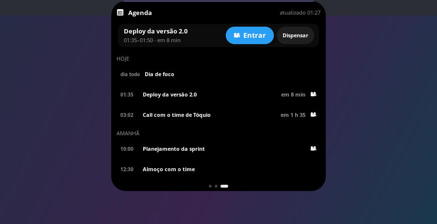
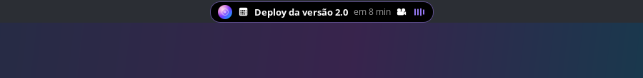
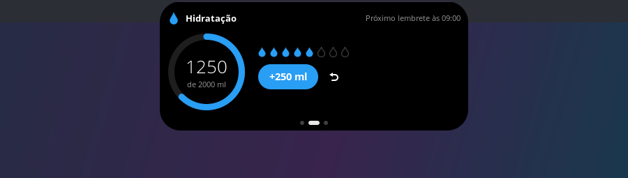
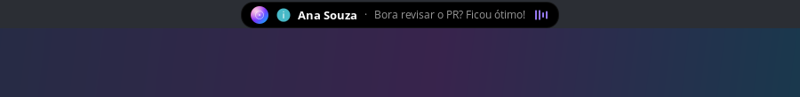

<div align="center">

# linux-island

**A Dynamic Island que faltava no seu Linux.**

Hora, clima, música, agenda, notificações e lembretes, tudo numa pílula elegante no topo da tela, que se abre quando você precisa e some quando não precisa.


</div>

---

## ✨ Por que linux-island?

O topo da tela é o lugar mais valioso do seu desktop, e quase sempre está ocupado só por um relógio. O **linux-island** troca esse relógio por uma ilha viva:

- **Discreta quando você está focado.** Uma pílula com hora, data, clima e o que está tocando.
- **Completa quando você precisa.** Passe o mouse e ela se abre com previsão, controles de música, sua agenda e seus lembretes.
- **Atenta a você.** Avisa de reuniões, notificações e da hora de beber água, sem sair de onde você está.

Leve, bonita e feita para o Linux, sem Electron e sem navegador embutido.

---

## 🎵 Sua música, sempre à vista

Spotify, YouTube no navegador, VLC, mpv, Rhythmbox… **o que estiver tocando aparece na ilha**, com capa, título e um equalizador na cor do álbum.

- **Troca de música?** A pílula se estica por alguns segundos mostrando a faixa nova e depois volta ao relógio.
- **Abriu outro player?** Se ele começou a tocar, a ilha passa para ele sozinha.
- **Controles completos** na ilha aberta: voltar, play/pause, avançar, barra de progresso e volume.
- **Volume na rodinha do mouse**: role sobre a ilha para subir ou baixar.
- **No Spotify**, a ilha ainda mostra **qual playlist** está tocando e **em qual aparelho** (celular, caixa de som, TV…).

## ⛅ Hora, data e clima

- Relógio em 24h ou 12h, com a data por extenso.
- **Clima agora** e **previsão de 5 dias**, com chance de chuva, para a sua cidade.
- A cidade é detectada sozinha, ou você escolhe.

## 📅 Sua agenda no topo da tela



Conecte sua conta do **Google**, pessoal ou corporativa, e veja o seu dia sem abrir nada:

- **Antes de cada reunião**, a pílula avisa com contagem regressiva e um som discreto:

  

- **Um clique em "Entrar"** e você está na chamada do Google Meet.
- Seus compromissos de **hoje**, **amanhã** e dos próximos dias, organizados.
- Reuniões que você recusou não aparecem.

## 💧 Lembrete de beber água



Defina sua meta e a ilha cuida do resto: lembra na hora certa, com um aviso sonoro e um brilho azul na pílula, e você registra cada copo com um clique. O dia zera sozinho à meia-noite.

## 🔔 Notificações, do jeito da ilha



Quando um app manda uma notificação, a pílula se estica mostrando **quem notificou e o que disse**. Várias de uma vez? Elas entram em fila. Clique e o app abre.

Tem **não perturbe**, opção de **esconder o texto** em apresentações e uma lista de **apps ignorados**.

## 🎨 Do seu jeito

- **Temas prontos**: Clássico, Vidro, Claro, Spotify e Grafite. Ou monte o seu, com cores, transparência e cantos.
- **Em português, inglês ou espanhol**, seguindo o idioma do sistema ou o que você escolher.
- Tudo se ajusta numa tela de configurações com o mesmo visual da ilha, e as mudanças aparecem na hora.

---

## 🖱️ Gestos

| Você faz | A ilha faz |
|---|---|
| Passa o mouse | se abre |
| Clica numa área livre | abre ou fecha |
| Arrasta para o lado (com ela aberta) | troca de página: música e clima ↔ água ↔ agenda |
| Rola a rodinha | muda o volume da música |
| Clica com o botão do meio | play / pause |
| Clica numa notificação | abre o app que notificou |
| Clica com o botão direito | abre o menu: Configurações, abrir o player, Sair |

## 🔒 Privacidade

- **Seus dados ficam com você.** O contador de água, as notificações e as configurações nunca saem do seu computador.
- **Agenda e Spotify são somente leitura.** As chaves de acesso ficam no **chaveiro protegido do sistema**, e "Sair da conta" remove o acesso na hora.
- Para o **clima**, a ilha consulta o [Open-Meteo](https://open-meteo.com/) e, se você não escolher uma cidade, descobre a sua pelo IP via [ipwho.is](https://ipwho.is/).

## 🐧 Onde funciona

| Ambiente | |
|---|---|
| **COSMIC** (Pop!_OS 24.04) | ✅ testado; ocupa o lugar do relógio do painel |
| **Hyprland, Sway, river, niri, Wayfire** | 🟡 deve funcionar |
| **KDE Plasma** (Wayland) | 🟡 deve funcionar |
| **GNOME** | ❌ ainda não |
| **X11** | ❌ não |

Testou em outro ambiente? [Conte para a gente](https://github.com/mrlazarias/linux-island/issues).

## 📄 Licença

[MIT](LICENSE): use, modifique e compartilhe à vontade.

---

## 🚀 Como usar

### 1. Instale

No Ubuntu, Pop!_OS ou Debian:

```bash
sudo apt install python3-gi python3-gi-cairo gir1.2-gtk-3.0 gir1.2-gtklayershell-0.1
git clone https://github.com/mrlazarias/linux-island.git
cd linux-island
./run.sh
```

<details>
<summary>Sem permissão de administrador (sudo)?</summary>

O `run.sh` usa sozinho uma cópia local do gtk-layer-shell em `vendor/`, se ela existir:

```bash
mkdir -p vendor/debs && cd vendor/debs
apt-get download gir1.2-gtklayershell-0.1 libgtk-layer-shell0
for f in *.deb; do dpkg-deb -x "$f" ../root; done
```

</details>

### 2. Abra as configurações

Clique com o **botão direito** na ilha e escolha **Configurações…**, ou rode `./run.sh --settings`.

| Aba | O que você ajusta |
|---|---|
| **Aparência** | temas, cores, transparência, cantos e borda |
| **Relógio e clima** | 12h/24h, data e clima na pílula, cidade, °C ou °F |
| **Comportamento** | abrir ao passar o mouse, mostrar a música nova, volume pela rodinha, players ignorados, posição, idioma, iniciar com a sessão |
| **Notificações** | mostrar na pílula, não perturbe, duração, esconder o texto, apps ignorados |
| **Água** | meta, tamanho do copo, intervalo, horário, adiar, som e notificação |
| **Agenda** | entrar com Google, dias à frente, quanto antes avisar, som |
| **Spotify** | conectar a conta para ver playlist e aparelho |

### 3. Coloque a ilha no lugar do relógio (COSMIC)

A ilha fica por cima do painel. Para tirar o relógio original de baixo dela, remova o applet de hora do centro do painel nas configurações de applets do COSMIC, ou pelo terminal:

```bash
P=~/.config/cosmic/com.system76.CosmicPanel.Panel/v1
cp $P/plugins_center $P/plugins_center.backup   # para voltar depois
printf 'Some([])' > $P/plugins_center
```

Em outros ambientes, esconda o relógio da sua barra (Waybar, painel do Plasma…) ou ajuste a posição em *Comportamento → Distância do topo*.

### 4. Abra junto com o computador

Ligue *Configurações → Comportamento → Iniciar com a sessão*.

### 5. Conecte sua agenda

Em *Configurações → Agenda*, clique em **Entrar com Google** e autorize no navegador.

<details>
<summary>Para quem distribui o linux-island: as credenciais do app do Google</summary>

O login usa um app OAuth do tipo **App para computador**. A ilha procura as credenciais em `~/.config/linux-island/google_client_secret.json` (um app próprio) e depois em `google_client.json`, na pasta do projeto (o app oficial).

1. No [Google Cloud Console](https://console.cloud.google.com/), crie um projeto e ative a **Google Calendar API**.
2. Em **Tela de consentimento OAuth**, escolha **Externo**, adicione o escopo `calendar.readonly` e **publique o app**. Em modo de teste, só usuários cadastrados entram, e o login expira a cada 7 dias.
3. Em **Credenciais → ID do cliente OAuth → App para computador**, baixe o JSON.

Até a verificação do Google, quem entrar vê o aviso "O Google não verificou este app", e o limite é de 100 usuários.

</details>

### 6. Veja playlist e aparelho do Spotify (opcional)

1. Em [developer.spotify.com/dashboard](https://developer.spotify.com/dashboard), crie um app. A conta precisa ser Premium.
2. Em **Redirect URIs**, adicione `http://127.0.0.1:8974/callback` e marque **Web API**.
3. Copie o **Client ID**, cole em *Configurações → Spotify* e clique em **Conectar**.

### Dicas

- `./run.sh --city "Belo Horizonte"` usa outra cidade só nesta vez.
- `./run.sh --margin 2` muda a distância do topo só nesta vez.
- Rodar `./run.sh` de novo com a ilha aberta não cria uma segunda ilha.
